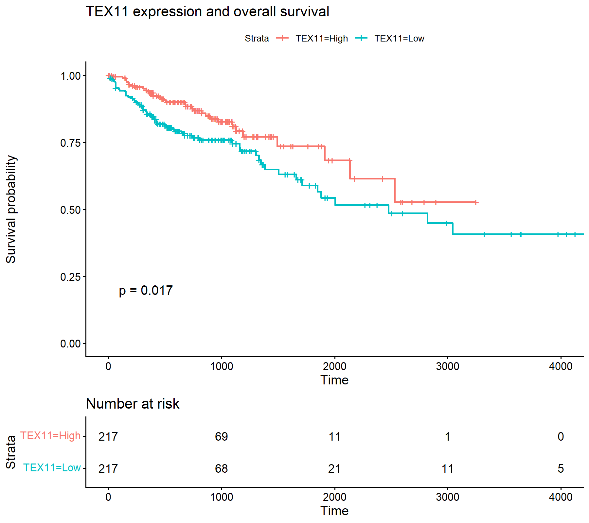
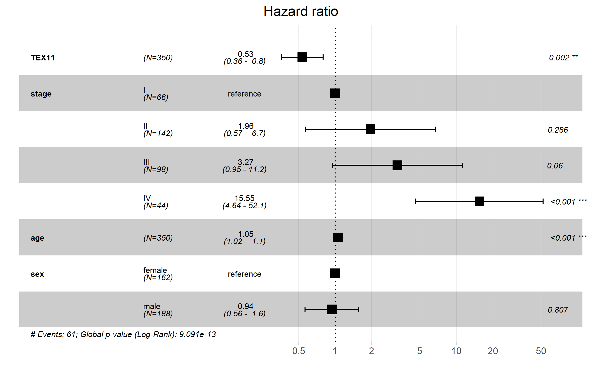
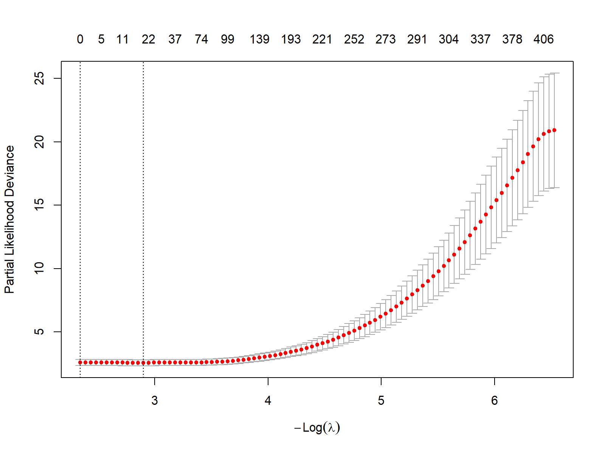
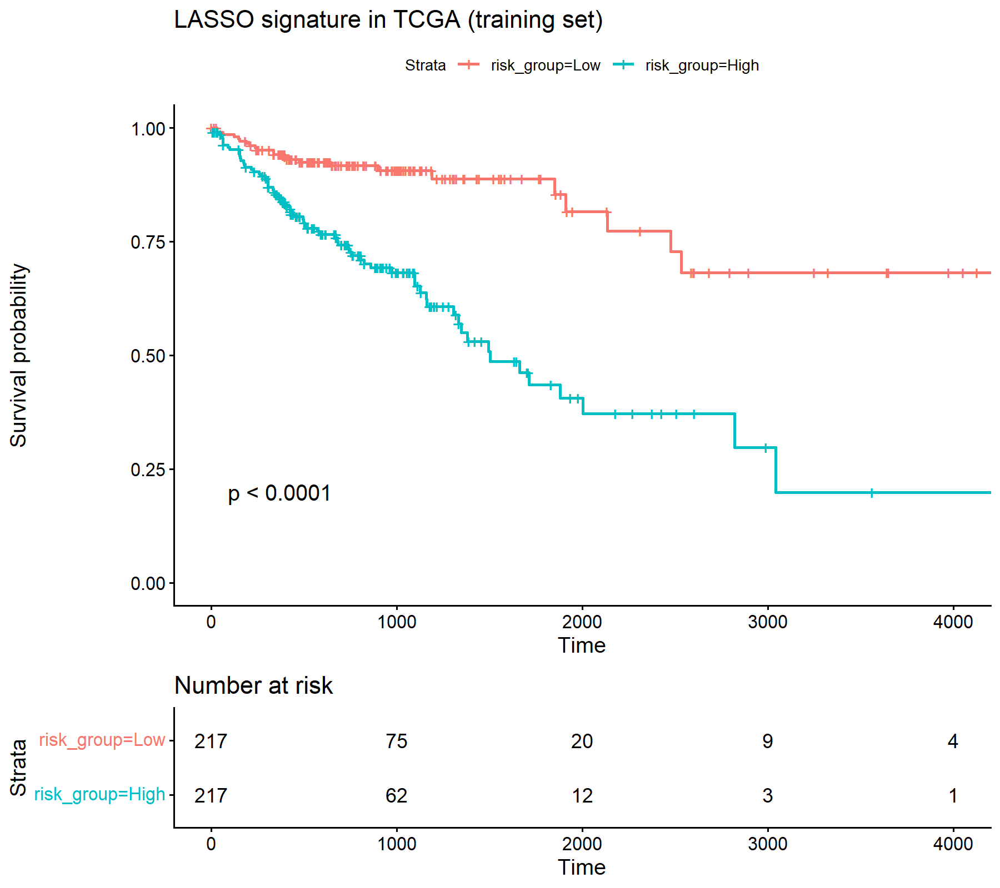
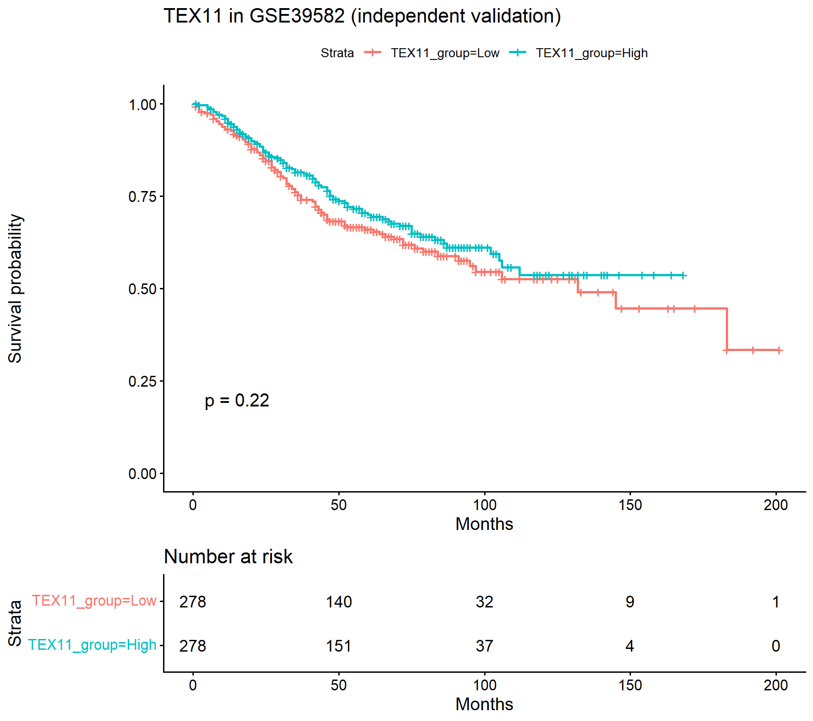

# Tumour vs Normal Gene Expression and Survival in Colon Cancer (TCGA-COAD, validated in GSE39582)

**Poster:** [doi.org/10.13140/RG.2.2.16664.15368](https://doi.org/10.13140/RG.2.2.16664.15368)  
**Code archive (Zenodo):** [doi:10.5281/zenodo.23623271](https://doi.org/10.5281/zenodo.23623271)

## Aim
Identify genes differentially expressed between colon tumours and normal colon tissue, test whether they relate to patient survival, and validate any prognostic candidates in an independent cohort.

## Data
- Source: TCGA-COAD, via the NCI Genomic Data Commons (TCGAbiolinks)
- RNA-seq raw counts (STAR - Counts, unstranded)
- 481 primary tumours, 41 solid tissue normals
- Excluded: 1 metastatic and 1 recurrent sample (too few to analyse)
- Note: groups are unbalanced (481 vs 41), a known TCGA limitation
- Validation cohort: GSE39582 (Marisa et al.), Affymetrix HG-U133 Plus 2.0 (GPL570), 566 primary colon adenocarcinomas with overall survival; 19 normal mucosa samples excluded

## Methods
1. **Download and preparation** (`scripts/01_download_data.R`): queried and downloaded STAR gene counts with TCGAbiolinks and merged them into one SummarizedExperiment (60,660 genes × 522 samples).
2. **Filtering and quality control** (`scripts/02_filter_pca.R`): kept genes with at least 10 reads in at least 41 samples (the size of the smallest group), leaving 24,300 genes. Counts were transformed with DESeq2's variance stabilising transformation (VST, blind to group), and the samples were checked by PCA on the 500 most variable genes.
3. **Differential expression** (`scripts/03_differential_expression.R`): DESeq2 with design `~ condition` (normal as reference). Genes were tested against a log2 fold change threshold of 1 (`lfcThreshold = 1`), with significance at Benjamini–Hochberg adjusted p < 0.05. Results were visualised with a volcano plot (EnhancedVolcano) and a heatmap of the top 25 up- and 25 down-regulated genes (pheatmap, row z-scores of VST counts).
4. **Pathway analysis** (`scripts/04_pathway_analysis.R`): over-representation analysis with clusterProfiler, run separately for up- and down-regulated genes, using all 24,300 tested genes as the background (universe). GO Biological Process terms were tested with `enrichGO` (Ensembl IDs) and KEGG pathways with `enrichKEGG` (Ensembl IDs converted to Entrez with `bitr`). Significance was set at BH-adjusted p < 0.05.
5. **Survival analysis** (`scripts/05_survival_analysis.R`): tumour samples only, using VST expression (not blind to group). Overall survival time was days to death, or days to last follow-up for censored patients. Patients with unreported vital status or missing or zero follow-up time were removed, and one sample was kept per patient, leaving 434 patients (95 deaths). Each of the top 100 DEGs was tested with a univariate Cox proportional hazards model, and p-values were BH-adjusted across the 100 genes. The top exploratory gene was shown with a Kaplan–Meier curve (median split, log-rank test; survival and survminer).
6. **Multivariable survival** (`scripts/06_multivariable_cox.R`): AJCC stage was collapsed to I–IV, with age at diagnosis and sex at birth. In the 350 patients with complete data (61 deaths), TEX11 was tested in a Cox model adjusted for stage, age and sex. The added value of TEX11 was assessed with a likelihood ratio test against the clinical-only model and with the concordance index; proportional hazards were checked with `cox.zph`.
7. **LASSO-Cox signature** (`scripts/07_lasso_signature.R`): penalised Cox regression (glmnet, alpha = 1) with 10-fold cross-validation (seed 2026) on the 434 tumour patients, using 2,970 protein-coding DEGs as candidates, with a sensitivity analysis using all 16,455 expressed protein-coding genes. Genes at lambda.min formed the risk score.
8. **Independent validation** (`scripts/08_geo_validation.R`): GSE39582 was downloaded with GEOquery (RMA, log2). TEX11 was measured with probe 221259_s_at (highest mean of 3 probes). The TCGA models were applied unchanged (TEX11 alone, and adjusted for stage, age and sex). The 17-gene signature was transferred using per-standard-deviation weights from TCGA and within-cohort z-scores in GEO (highest-mean probe per gene; 15 of 17 genes available). Survival time in GSE39582 is in months.

## Results
### Quality control
Tumour and normal samples separate clearly along PC1 (23% of variance). Normals cluster tightly, while tumours are more heterogeneous, consistent with known colorectal cancer subtypes. No outliers were removed.

### Differential expression
**4,821 genes** were differentially expressed (|log2FC| > 1, padj < 0.05): **2,868 up-regulated** and **1,953 down-regulated** in tumours. The full list is in `results/deg_tumour_vs_normal.csv`.

- Top up-regulated genes include CDH3, KRT80, ETV4, SIM2, ESM1, FOXQ1, CEMIP, CLDN1 and WNT2, which point to Wnt signalling, invasion and angiogenesis.
- Down-regulated genes include markers of mature colon epithelium (GUCA2B, AQP8, CLCA4, BEST4, OTOP2, CA7), consistent with loss of normal differentiation in tumours.

### Pathway analysis
- **Up in tumour:** KEGG pathways included **Wnt signalling**, the central pathway in colorectal cancer, along with **Cell cycle**, **Homologous recombination**, **Hippo signalling**, and **IL-17 and cytokine signalling**, which point to inflammation in the tumour environment. The top GO terms were developmental and morphogenesis programmes, epithelial differentiation and keratinization, and antimicrobial humoral response.
- **Down in tumour:** normal colon functions (**Mineral absorption**, **Bile secretion**), plus muscle-contraction, neuroactive, calcium and cAMP signalling terms. The latter most likely reflect the smooth muscle and enteric nerve tissue present in normal samples rather than changes inside tumour cells.
- Full tables are in `results/go_up.csv`, `results/go_down.csv`, `results/kegg_up.csv` and `results/kegg_down.csv`.

### Survival analysis
- **No gene among the top 100 DEGs was associated with overall survival after multiple-testing correction** (all BH-adjusted p ≥ 0.46). Genes that separate tumour from normal tissue are not necessarily prognostic among tumours, and 95 deaths give limited power to detect modest effects.
- The strongest exploratory candidate was **TEX11** (hazard ratio 0.62 per unit of VST expression, unadjusted p = 0.006): higher expression went with better survival. In a median split, patients with high TEX11 had better survival than those with low TEX11 (log-rank p = 0.017). Because TEX11 was chosen from a screen of 100 genes and does not survive correction, this needs validation in an independent cohort.
- The full Cox table is in `results/cox_top100_degs.csv`.

### Multivariable survival (TCGA)
In 350 patients with complete stage, age and sex (61 deaths), TEX11 remained associated with better survival after adjustment: **HR 0.53 (95% CI 0.36–0.80), p = 0.002**. Stage IV (HR 15.6) and age (HR 1.05 per year) were strong predictors; sex was not (HR 0.94, p = 0.81). Adding TEX11 improved the clinical model (likelihood ratio test p = 0.0016; concordance 0.78 → 0.80). The proportional hazards assumption held (global p = 0.80). Because TEX11 was selected from 100 candidates in the same cohort, this estimate is expected to be optimistic.

### LASSO-Cox signature (TCGA)
With 2,970 protein-coding DEGs, LASSO kept **17 genes**, but the cross-validated partial likelihood deviance (2.578) was barely lower than the no-gene model (2.598; SE 0.24), and the more conservative lambda.1se selected no genes. Using all 16,455 protein-coding genes gave the same deviance as the null model (2.601 vs 2.601). **No robust prognostic signature was found.** The training-set Kaplan–Meier split (p < 0.0001) is shown for transparency only; it is optimistic by construction.

### Independent validation (GSE39582)
In 556 tumours with overall survival (187 deaths):
- **TEX11 did not replicate**: HR 0.96 (95% CI 0.72–1.28), p = 0.78 alone; **HR 1.05 (0.78–1.40), p = 0.76** adjusted for stage, age and sex; log-rank p = 0.22 for a median split. The confidence interval excludes the TCGA estimate.
- **The 17-gene signature did not replicate independently**: HR 1.61 (0.99–2.60), p = 0.055 alone, and HR 1.30 (0.78–2.15), p = 0.32 after adjustment.
- The clinical covariates replicated as expected (Stage IV HR 9.5, age HR 1.03 per year, male sex HR 1.45), indicating a sound cohort and model.

### Conclusion
Genes that best distinguish colon tumours from normal tissue carry little prognostic information. A candidate (TEX11) that appeared independently prognostic in TCGA, and a LASSO signature with a strong training-set curve, both failed in an independent cohort, while stage and age replicated. This highlights the need for external validation of transcriptomic biomarkers.

## Tools
R 4.6.1, TCGAbiolinks, SummarizedExperiment, DESeq2 1.52.0, EnhancedVolcano 1.30.0, pheatmap 1.0.13, clusterProfiler 4.20.2, org.Hs.eg.db, survival 3.8.6, survminer 0.5.2, glmnet 5.1, GEOquery 2.80.0, limma 3.68.5. Full package versions: `sessionInfo.txt`.

## Status
Chapter 1 (discovery) and Chapter 2 (multivariable models, LASSO signature, independent validation) are complete. Manuscript in preparation.

## How to reproduce
1. Install R (4.6.1) and the packages listed above (Bioconductor packages via `BiocManager`).
2. Open `tcga-crc-analysis.Rproj` in RStudio.
3. Run the scripts in order, `scripts/01_download_data.R` to `scripts/08_geo_validation.R`. Script 01 downloads TCGA data (~2 GB) and script 08 downloads GSE39582 into `data/`, which is not tracked by Git.

## Citation
Ogunsola SB. Colon tumours vs normal colon: differential gene expression, pathways and survival in TCGA-COAD RNA-seq [Poster]. ResearchGate; 2026. doi:10.13140/RG.2.2.16664.15368

## License
MIT (see `LICENSE.md`).
